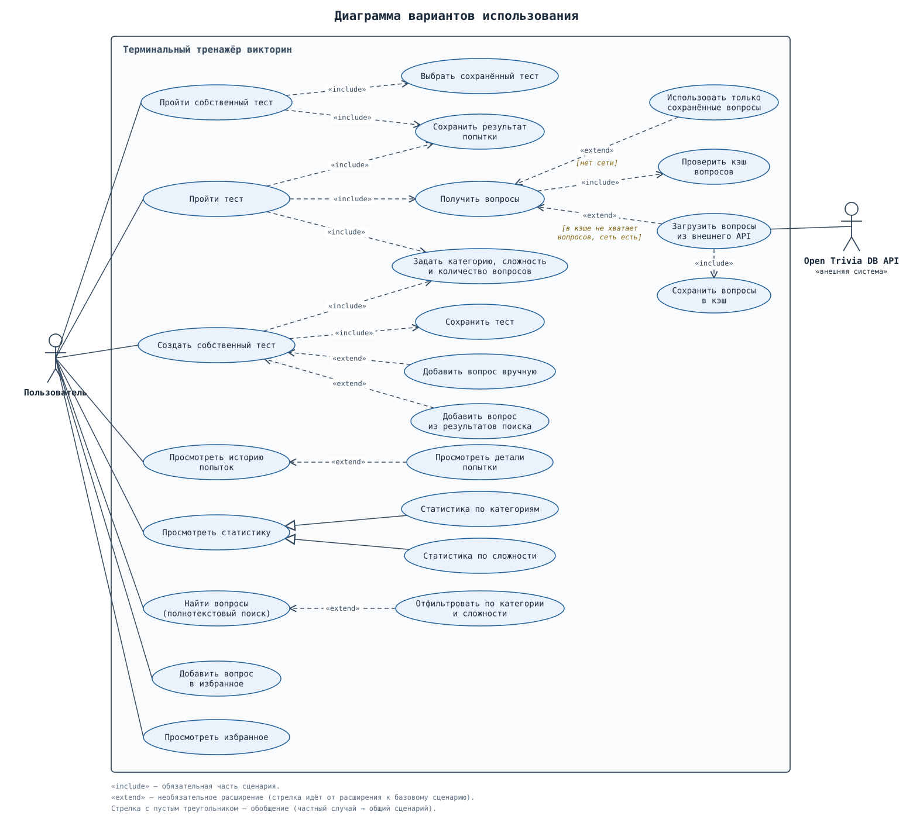
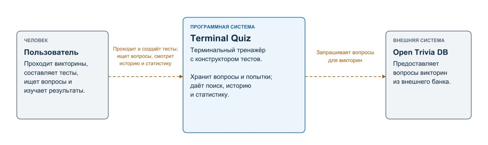
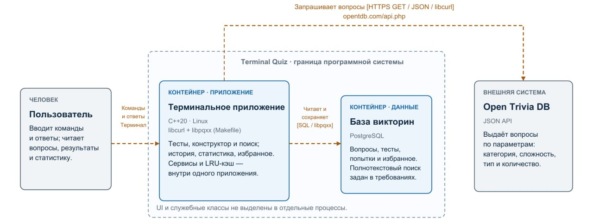

# Терминальный тренажер викторин

Курсовой проект по дисциплине **Конструирование программного обеспечения**.

Представляет собой терминальное приложение, позволяющее:
1. Проходить викторины на основе вопросов из Open Trivia DB.
2. Настраивать категорию, сложность и количество вопросов.
3. Собирать пользовательские тесты.
4. Добавлять избранные вопросы.
5. Искать вопросы по тексту.
6. Отслеживать прогресс по категориям и сложности.
7. Работать в офлайн-режиме за счет локального кэша вопросов.

---

## Участники проекта

| ФИО | Группа | Роль в проекте | Профиль |
|-----|--------|----------------|---------|
| _Абрамов Владислав Николаевич_ | _5130904/40104_ | _архитектура, api, api tests, app, app tests, tui tests, контейнеризация_ | _15446-rus75_ |
| _Александров Игорь Артемович_ | _5130904/40104_ | _core, core tests, services, services tests, tui, user scenarios_ | _MrMels625_ |
| _Казак Егор Витальевич_ | _5130904/40104_ | _db, db tests, util, util tests, C4 models_ | _CuatHimBong_ |

---

## 1. Определение проблемы

Студентам и всем, кто готовится к викторинам, экзаменам и квизам, сложно тренироваться регулярно: ручной поиск и подбор вопросов по нужной теме отнимает время, а разрозненные тренировки не дают понять, какие темы усвоены слабо. Пользователям не хватает единого инструмента, который позволял бы проходить тесты с настраиваемой категорией, сложностью и количеством вопросов, собирать собственные подборки и отслеживать прогресс.

---

## 2. Выработка требований

### 2.1 Пользовательские сценарии

1. Когда у меня есть свободные 10 минут, я хочу указать категорию, сложность и количество вопросов и сразу пройти тест в терминале, чтобы тренироваться без ручного поиска вопросов.
2. Когда я закончил тест, я хочу видеть историю попыток, статистику по категориям и сложности и открыть любую попытку, чтобы понять, какие темы даются хуже, и вернуться к своим ошибкам.
3. Когда я готовлюсь к конкретной теме, я хочу собрать и сохранить собственный тест из вопросов, подобранных по фильтрам и добавленных вручную, чтобы проходить его повторно.
4. Когда мне попался интересный или сложный вопрос, я хочу найти его по тексту среди сохраненных и добавить в избранное, чтобы быстро к нему вернуться.
5. Когда доступа к интернету нет, я хочу проходить тесты на уже сохраненных вопросах, чтобы тренировка не прерывалась.

### 2.2 Диаграмма вариантов использования



### 2.3 Оценка аудитории и нагрузки

- Целевая аудитория - студенты, готовящиеся к квизам и экзаменам. Ориентир: 10000 активных пользователей в сутки.
- Средний пользователь проходит 3 викторины в день, то есть 30000 сессий в сутки.
- Средняя викторина - 20 вопросов.

### 2.4 Период хранения данных

История попыток и статистика хранятся 5 лет, что позволяет пользователю отслеживать долгосрочный прогресс.

---

## 3. Разработка архитектуры и детальное проектирование

### 3.1 Характер нагрузки

- **Соотношение чтения и записи.** Запись происходит один раз за викторину. Чтение доминирует за счет повторяющихся операций аналитики и просмотра статистики.
- **Внешний трафик.** Один пакет из 20 вопросов имеет вес приблизительно 8 Кб. На 30000 сессий приходится приблизительно 234 Мб.
- **Внутренний трафик.** Маленькие запросы в пределах нескольких Кб.
- **Объем дисковой системы.** За 5 лет порядка 150000 уникальных вопросов по 0.6 Кб, 54,7 млн попыток по 100 Б, 1 млрд 94 млн ответов по 80 Б, итого 93 - 100 Гб.

### 3.2 Модель C4

#### Уровень 1 - контекст системы



#### Уровень 2 - контейнеры

 

### 3.3 Контракты и нефункциональные требования по времени отклика

**Внешний контракт - Open Trivia DB API** (https://opentdb.com/api.php)

| Параметр | Тип | Назначение |
|----------|-----|------------|
| `amount` | int (1–50) | число вопросов |
| `category` | int | категория (0 = любая) |
| `difficulty` | enum | easy / medium / hard |
| `type` | enum | multiple / boolean |

Ответ - JSON с массивом вопросов, при недоступности или таймауте приложение переключается на локальную БД.

**Внутренние контракты сервисного слоя**
- `QuestionService::fetchQuestions(amount, category, difficulty, type)` - вернуть список вопросов.
- `QuizService::startQuiz` / `submitAnswers` / `finishQuiz` - жизненный цикл попытки.
- `HistoryService::recent` / `details`, `StatisticsService::getOverall` / `getByCategory` / `getByDifficulty`, `FavoriteService`, `CustomTestService` - основные вспомогательные сервисы.

**Нефункциональные требования по времени отклика**
| Операция | Целевое время |
|----------|---------------|
| Получение вопросов (попадание в кэш) | < 50 мс |
| Получение вопросов (внешний API, с таймаутом и fallback) | < 2 c |
| Сохранение попытки и ответов | < 100 мс |
| Запрос статистики / истории | < 300 мс |
| Отклик интерфейса на команду | < 100 мс |

### 3.4 Схема базы данных



**Почему схема выдерживает нефункциональные требования:**
- Индексы под горячие запросы.
- Пакетная запись.
- Предподготовленные выражения.
- Целостность.
- Идемпотентная миграция.

### 3.5 Масштабирование при росте нагрузки в 10 раз

1. **Уровень приложения.** Запуск нескольких экземпляров, вынос общего кэша.
2. **Уровень БД (чтение).** Реплики только для чтения для статистики и истории - самых частых читающих операций, маршрутизация читающих запросов на реплики.
3. **Уровень БД (запись/объем).** Секционирование таблиц с попытками и вопросами по диапазону времени.
4. **Снижение нагрузки.** Пакетные вставки, кэш вопросов, подготовленные выражения.
5. **Внешний API.** Кэш вопросов защищает от роста квот.

---

## 4. Кодирование и отладка

### 4.1 Организация кода

Код разбит на слои с **инверсией зависимостей**: верхние слои зависят от интерфейсов, а не конкретных реализаций, что позволяет создавать слабосвязанные модули и тестировать их изолированно друг от друга.


| Слой | Каталог |
|------|---------|
| Доменные модели | core |
| Утилиты | util |
| Внешний API | api |
| Доступ к данным | db |
| Сервисы | service |
| Интерфейс | tui |
| Композиция | app | 

Ключевые конструкторские решения:
- **Внедрение зависимостей через конструкторы.** std::shared_ptr на интерфейсы. Все сервисы и экраны принимают зависимости извне.
- **Паттерн "Репозиторий"** для доступа к данным. Слой сервисов не зависит от SQL.
- **Разделение представления и логики.** Рендеринг отделен от бизнес-логики, ввод/вывод абстрагирован интерфейсом.
- **Централизованная обработка ошибок.** Прикладной уровень перехватывает исключения и преобразует их в соответствующие сообщения об ошибках, аварийное завершение происходит только при невозможности запуска программы.

### 4.2 Инструменты контроля качества и отладки

- **Единый стиль кода:** clang-format
- **Статический анализ:** clang-tidy
- **Проверка самодостаточности заголовков:** изолированная компиляция заголовков через make check-headers
- **Поиск утечек и ошибок памяти:** valgrind
- **Предпроверка pull requests:** GitHub Actions

### 4.3 Процесс разработки

Работа велась через pull requests: каждый слой реализовывался в отдельной ветке и проходил код-ревью до слияния.

---

## 5. Модульное (unit) тестирование

### 5.1 Подход

Используется библиотека Boost.Test. Тесты организованы послойно, у каждого своя директория со своим Makefile, что позволяет тестировать слои по отдельности.

Принципы, которым следуют тесты:
- Проверяются **поведение и контракты**: граничные значения, исключения, идемпотентность, порядок обработки.
- Зависимости **подменяются.**
- Проверяются **негативные сценарии**: nullptr в конструкторах, невалидный ввод, отсутствующие записи, сбои внешнего сервиса.

### 5.2 Пример

```cpp
BOOST_AUTO_TEST_CASE(pool_rolls_back_abandoned_and_failed_transactions)
{
  auto source = database();
  auto connection = source->getConnection();
  connection->execute("CREATE TEMP TABLE lease_probe(value integer)", {});
  const auto PID = connection->execute("SELECT pg_backend_pid()", {}).at(0).at(0);
  connection->beginTransaction();
  connection->execute("INSERT INTO lease_probe VALUES(1)", {});
  connection.reset();
  connection = source->getConnection();
  BOOST_CHECK_EQUAL(connection->execute("SELECT pg_backend_pid()", {}).at(0).at(0), PID);
  BOOST_CHECK_EQUAL(connection->execute("SELECT COUNT(*) FROM lease_probe", {}).at(0).at(0), "0");
  connection->beginTransaction();
  BOOST_CHECK_THROW(connection->execute("SELECT 1 / 0", {}), std::runtime_error);
  connection.reset();
  connection = source->getConnection();
  BOOST_CHECK_EQUAL(connection->execute("SELECT 7", {}).at(0).at(0), "7");
}
```

### 5.3 Запуск

```bash
make test #запуск всех тестов
make test-слой #запуск теста одного слоя
```

## 6. Интеграционное тестирование

### 6.1 Сценарий, покрывающий пользовательскую историю

Интеграционные тесты (src/test/app) воспроизводят работу пользователя без реального терминала. При этом поднимается настоящая база данных, и тестируются все слои приложения.

#### Сценарий 1.

1. Пользователь запускает приложение.
2. Открывает экран play a quiz.
3. Указывает параметры: 3 вопроса, категория Any, сложность Any, тип вопросов Any.
4. Отвечает на каждый вопрос.
5. После вопросов видит статистику по квизу.
6. Выходит из приложения.

#### Сценарий 2.

1. Пользователь начинает квиз на 3 вопроса как в Сценарии 1.
2. Возвращается в главное меню и открывает экран history.
3. Видит список попыток и открывает детали первой попытки.
4. Вводит два раза "/back" и возвращается в главное меню.
5. Открывает статистику
6. Выходит из приложения.

#### Сценарий 3.

1. Пользователь начинает квиз на 3 вопроса как в Сценарии 1.
2. На первом вопросе вводит /fav.
3. Отвечает на оставшиеся вопросы.
4. В главном меню открывает избранные вопросы и меню действий.
5. Вводит "/back" и возвращается в главное меню.
6. Выходит из приложения.

#### Сценарий 4.

1. Пользователь в главном меню открывает экран search questions.
2. Вводит поисковый текст "Seeded", категорию Any, сложность Any или лимит 5.
3. Видит список найденных вопросов.
4. На предложение "Add some of these questions to favorites?" отвечает "y".
5. Указывает диапазон "1-2" - выбирает первые два найденных вопроса.
6. Видит подтверждение "Added 2 question(s) to favorites".
7. Выходит из приложения.

#### Сценарий 5.

1. Пользователь начинает квиз на 3 вопроса как в Сценарии 1.
2. Отвечает только на первый вопрос.
3. Вводит "/stop" и прерывает сессию.
4. Видит "Quiz finished" с итогом по фактически отвеченным вопросам.
5. Выходит из приложения.

### 6.2 Что проверяется на уровне БД-слоя

1. **Атомарность пакетных операций.** Отсутствие частичных записей и корректный откат транзакций при сбое внутри пакета.
2. **Целостность внешних ключей.** Блокируется попытка удаления вопроса, на который ссылаются попытка или тест.
3. **Идемпотентность.** Отсутствие дубликатов и возможность безопасного переиспользования схемы.
4. **Устойчивость пула соединений.** Исчерпание пула, таймаут, битые соединения обрабатываются корректно без утечек соединений.
5. **Инварианты.** Корректное время попыток, статистика, избранные вопросы и т.д.

### 6.3 Запуск

1. Однократное создание изолированной тестовой базы данных. sudo -u postgres psql -c "CREATE DATABASE quiz_test OWNER quiz;"
2. make test-app

---

## 7. Сборка и запуск

### 7.1 Локальная сборка

Проект собирается с помощью GNU Make.
1. **Проверка форматирования:** make check-format.
2. **Статический анализ:** make check-tidy, make check-cppcheck.
3. **Проверка заголовков:** make check-headers.
4. **Все проверки:** make check-all.
5. **Запуск тестов:** make test.
6. **Компиляция и компоновка:** make build.
7. **Запуск программы:** make run.

WIP

### 7.2 Запуск через Docker

WIP
